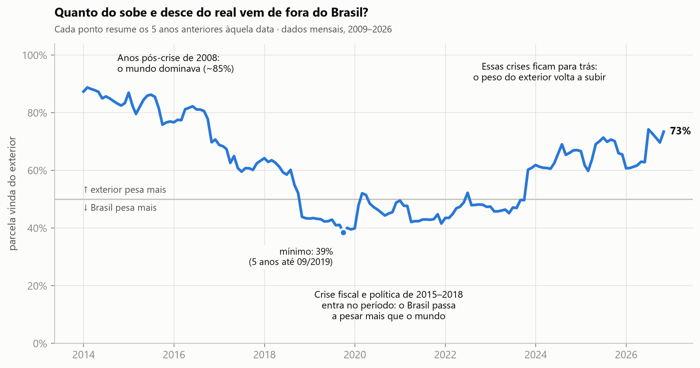
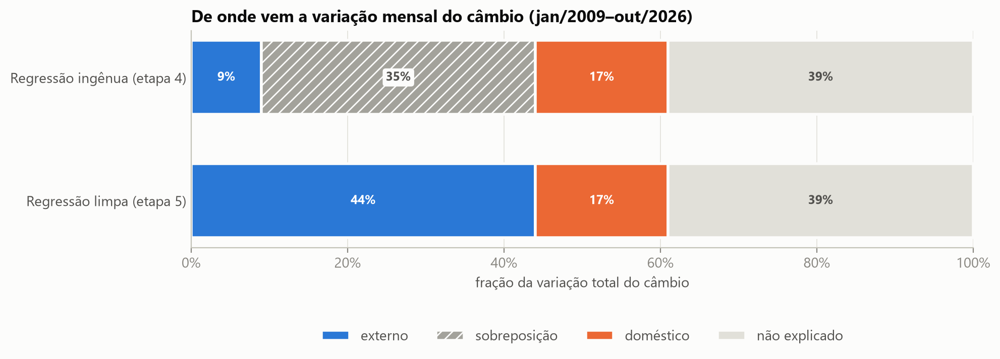
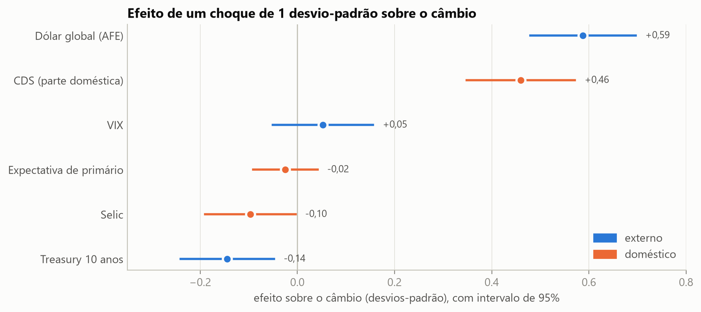
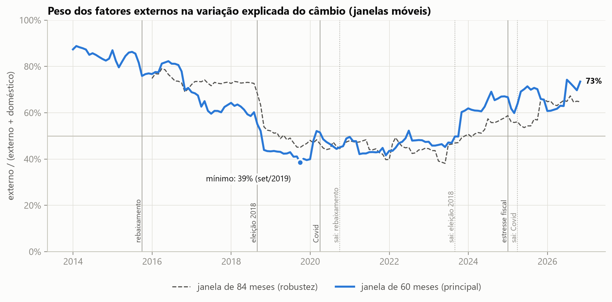

# Câmbio brasileiro: fatores externos ou domésticos?

## A pergunta

O que mexe mais com o real: o que acontece **lá fora** (juros americanos, aversão global ao risco,
força do dólar no mundo) ou o que acontece **aqui dentro** (Selic, risco-país, expectativas fiscais)?

A pergunta surgiu numa discussão na faculdade. Cada lado tinha um episódio para defender, a crise
de 2015, a eleição de 2018, a Covid, e ninguém conseguia fechar a questão. Este projeto tenta
responder com dados.

**Resposta curta: depende do período.** Na média de 2009 a 2026, cerca de **63% da variação
explicada** do câmbio vem de choques externos e 37% de choques domésticos. Mas a divisão muda
bastante no tempo: nos anos que incluem a crise fiscal e política de 2015–2018, o Brasil passou a
pesar mais que o mundo.



## Principais conclusões

1. **Na média, o mundo pesa mais.** Dos ~59% da variação mensal do câmbio que o modelo explica,
   cerca de 2/3 vêm de fora e 1/3 de dentro.
2. **O canal externo é o dólar global, não os juros americanos.** Quando o dólar se fortalece contra
   as moedas desenvolvidas, o real cai junto — é a variável de maior efeito no modelo.
3. **O juro americano de 10 anos tem efeito pequeno e de sinal contrário ao esperado.** Em 6 dos 8
   piores meses do real, os juros americanos *caíram*: nas crises, investidores compram Treasuries
   (fuga para a qualidade) ao mesmo tempo em que vendem emergentes. O título de 10 anos funciona
   mais como termômetro de medo e de crescimento do que como canal do *carry trade*.
4. **O canal doméstico é o risco-país.** Selic e expectativa fiscal têm efeitos pequenos na variação
   mensal — provavelmente porque o mercado já as antecipa.
5. **O risco-país não é só "nosso".** Cerca de 35% da variação mensal do CDS brasileiro é contágio
   global, e quase metade do efeito do dólar global chega ao real **através** do risco-país.
6. **A divisão muda no tempo** (janela móvel de 5 anos, datada pelo fim):

   | Janelas terminando em | Peso externo no explicado | O que estava dentro da janela |
   |---|---|---|
   | dez/2013 – dez/2015 | 84% | Pós-crise de 2008, liquidez global abundante |
   | jan/2016 – jul/2018 | 68% | Crise fiscal e política de 2015–16 entrando |
   | ago/2018 – ago/2023 | 46% | Recessão, rebaixamento, impeachment, eleição de 2018 |
   | set/2023 – out/2026 | 65% | As crises de 2015–2018 saem da janela |

   O ponto mais baixo é **39% (janela terminando em set/2019)**, quando os cinco anos anteriores
   cobriam toda a crise doméstica.

## O que olhamos (e por quê)

Dados **mensais**, de jan/2009 a out/2026 (214 meses), sempre o valor do último dia útil do mês.

| Bloco | Variável | Fonte | Por que esta |
|---|---|---|---|
| Câmbio | PTAX de venda | BCB (SGS 1) | Taxa oficial de referência, usada em contratos e derivativos |
| Externa | Treasury 10 anos | FRED (DGS10) | Juros americanos de referência |
| Externa | VIX | FRED (VIXCLS) | Aversão global ao risco ("índice do medo") |
| Externa | Dólar vs. economias avançadas | FRED (DTWEXAFEGS) | Força global do dólar **sem** incluir o real na cesta |
| Doméstica | Meta Selic | BCB (SGS 432) | Política monetária |
| Doméstica | CDS 5 anos do Brasil | Investing.com | Risco-país, cotado diariamente até hoje |
| Doméstica | Resultado primário esperado | Focus/BCB | Expectativa fiscal do mercado |

## O que deixamos de fora (e por quê)

| Ficou de fora | Motivo |
|---|---|
| **Crise de 2008** | O CDS disponível tem preços parados (sem negociação) durante quase todo 2008; a amostra começa em 2009 |
| **EMBI+** como risco-país | Descontinuado em jul/2024. Usado só para validar o CDS: as variações mensais dos dois têm correlação de 0,84 |
| **DXY** e índice amplo do dólar (Broad) | O DXY tem pesos de 1973 (o euro pesa ~58%); o Broad **inclui o real**, o que criaria correlação mecânica com a variável explicada |
| **Dívida líquida** como variável fiscal | O Brasil é credor líquido em dólar: quando o real cai, a dívida líquida cai sozinha. Ela seria efeito do câmbio, não causa |
| **Dívida bruta** | Só existe no Focus desde 2018, curto demais para janelas de 5 anos |
| **Commodities, fluxo de capital, intervenções do BC** | Fora do escopo desta versão. São os candidatos naturais para reduzir os ~40% não explicados |
| **Dados diários ou semanais** | Mais ruído e problemas de horário (a PTAX fecha às 13h de Brasília; o VIX no fechamento de Nova York). Selic e Focus têm ritmo mensal |

## Metodologia

**1. Tratamento** ([03_tratamento](03_tratamento.ipynb)). Preços e índices (câmbio, dólar, VIX, CDS)
entram em variação percentual (100·Δln); taxas e % do PIB (Treasury, Selic, primário) em diferença
simples. A expectativa fiscal é convertida para um **horizonte fixo de 12 meses** — sem isso, a série
"salta" toda virada de ano, quando o Focus troca o ano de referência. Os testes ADF e KPSS confirmam
que todas as variações são estacionárias (os níveis do câmbio, do dólar e dos juros não são).

**2. Regressão** ([04_regressao](04_regressao.ipynb)). MQO com variáveis padronizadas (cada coeficiente
é o efeito de um choque de 1 desvio-padrão) e erros-padrão robustos HAC (Newey-West). Estimamos
três versões: só externas, só domésticas e todas juntas.

**3. O problema da sobreposição.** Somando o que cada bloco explica sozinho, passa-se do total: **30%
da variação é explicada pelos dois blocos ao mesmo tempo**, porque o CDS anda junto com o dólar
global e o VIX. Sem resolver isso, não dá para dizer quanto é externo.

| Método | Externo | Sobreposição | Doméstico | Não explicado | Externo / explicado |
|---|---|---|---|---|---|
| Regressão ingênua | 7% | 30% | 22% | 41% | indefinido |
| Regressão com risco-país "limpo" | 37% | 0% | 22% | 41% | **63%** |

*Cada linha divide 100% da variância mensal do câmbio. A última coluna ignora o não explicado.*



**4. Limpeza do risco-país** ([05_limpeza_risco](05_limpeza_risco.ipynb)). Cada variável doméstica é
regredida nas três externas; o **resíduo** é o componente genuinamente doméstico (a parte do CDS que
o cenário global não explica). Isso atribui a sobreposição ao bloco externo e reflete a hipótese de
**economia pequena e aberta**: no curto prazo, o mundo afeta o Brasil, e não o contrário.
Fazendo a limpeza no sentido inverso, o peso externo cairia de 63% para 12% — **a conclusão depende
dessa hipótese**, que é teórica, mas tem apoio empírico (ver Validação).



**5. Janelas móveis** ([06_janelas_moveis](06_janelas_moveis.ipynb)). A regressão limpa é refeita em
cada janela de 60 meses (e 84 meses, como robustez), deslizando um mês por vez. Cada ponto é datado
no **fim** da janela. Consequência importante para a leitura: um episódio afeta o gráfico por cinco
anos e **sai** de uma vez — o salto de out/2023, por exemplo, não vem de nada que aconteceu em 2023,
e sim da eleição de 2018 deixando a janela.



**Validação.** A pasta [extra_var/](extra_var/) estima um VAR com decomposição da variância (FEVD),
um método diferente que chega aos mesmos 63% e às mesmas fases. O teste de Granger feito lá não
encontra evidência de que o bloco doméstico antecipe o externo (p = 0,18), o que apoia a hipótese de
economia pequena e aberta.

## Limitações

- Cerca de **40% da variação mensal do câmbio não é explicada** pelo modelo.
- A divisão entre externo e doméstico **depende da hipótese** de que o mundo afeta o Brasil e não o
  contrário.
- Os efeitos medidos são **contemporâneos** (mesmo mês) e de associação, não causalidade estrita.
- As janelas móveis não têm intervalos de confiança: leia tendências de vários anos, não oscilações
  de um ou dois meses.

## Estrutura do repositório

| Arquivo | Conteúdo |
|---|---|
| [02_coleta](02_coleta.ipynb) | Coleta: SGS/BCB, Focus, FRED, IPEADATA e CDS |
| [03_tratamento](03_tratamento.ipynb) | Frequência mensal, transformações, horizonte fixo do Focus, testes de estacionariedade |
| [04_regressao](04_regressao.ipynb) | Regressões padronizadas com erros HAC e decomposição do R² |
| [05_limpeza_risco](05_limpeza_risco.ipynb) | Limpeza das domésticas e decomposição do risco-país |
| [06_janelas_moveis](06_janelas_moveis.ipynb) | Regressão limpa em janelas móveis |
| [07_resultados](07_resultados.ipynb) | Gráficos finais e tabela-resumo ([resumo.xlsx](resultados/resumo.xlsx)) |
| [extra_var/](extra_var/) | VAR e FEVD (validação por um segundo método) |

## Como reproduzir

1. Criar o ambiente:
   ```bash
   conda env create -f environment.yml
   conda activate cambio
   ```
2. Criar uma chave gratuita da API do FRED em <https://fred.stlouisfed.org> (*My Account → API Keys*)
   e guardá-la na variável de ambiente `FRED_API_KEY`.
3. Baixar manualmente o histórico diário do **CDS 5 anos do Brasil** no
   [Investing.com](https://www.investing.com/rates-bonds/brazil-cds-5-years-usd-historical-data)
   e salvar como `dados/brutos/cds_investing.csv`.
4. Rodar os notebooks em ordem, de `02` a `07`.

Os dados brutos não estão no repositório: as séries públicas são baixadas pelo `02_coleta`, e o CSV
do CDS e o VIX têm restrições de redistribuição. Como as fontes revisam dados, uma nova coleta pode
gerar números ligeiramente diferentes dos apresentados aqui (coleta em 07/11/2026).
